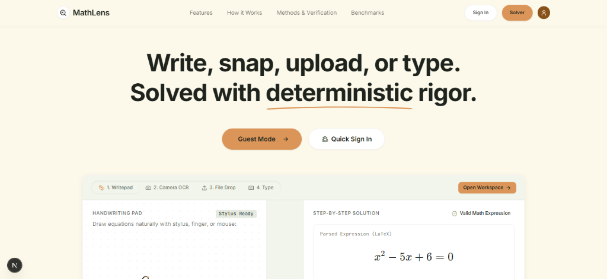
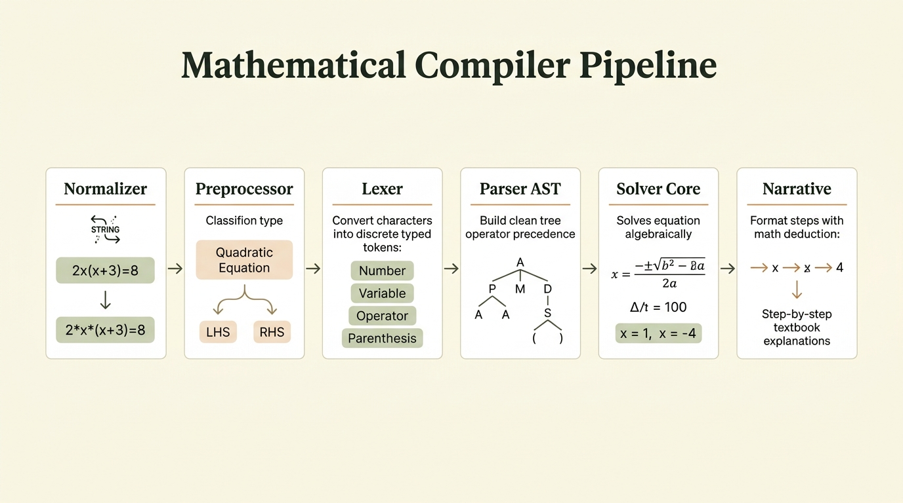
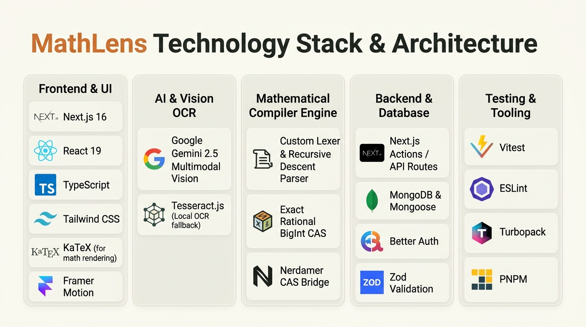
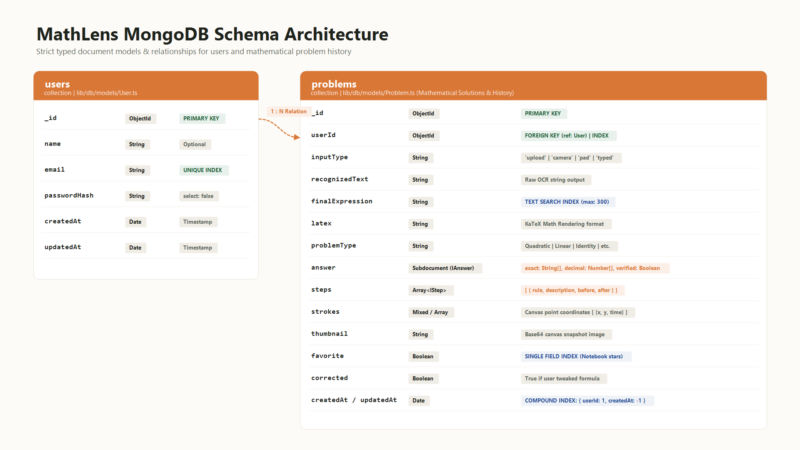

# MathLens 📐⚡

> **Write, snap, upload, or type. Solved with deterministic rigor.**  
> A hybrid mathematical compiler and step-by-step problem solver bridging multimodal vision with deterministic computer algebra.



<div align="center">

[](https://nextjs.org/)
[](https://react.dev/)
[](https://www.typescriptlang.org/)
[](https://tailwindcss.com/)
[](https://deepmind.google/technologies/gemini/)
[](https://katex.org/)
[](https://www.mongodb.com/)
[](https://vitest.dev/)
[](LICENSE)

</div>

---

## 💡 The Core Philosophy: Separation of Concerns

Traditional AI math solvers suffer from **stochastic hallucinations**—frequently making subtle arithmetic mistakes or inventing false intermediate steps because they predict tokens probabilistically. Conversely, traditional Computer Algebra Systems (CAS) require strict, non-ambiguous syntax and completely fail when handling uneven handwriting.

**MathLens solves this through a strict architectural boundary:**

1. **Half A: Recognition (Untrusted):** Multimodal AI Vision (Gemini 2.5 Flash) and local Tesseract.js transcribe noisy handwritten strokes or camera captures into clean LaTeX.
2. **Interactive Confirmation Gate:** The user visually verifies and can tweak any ambiguous symbol in seconds.
3. **Half B: Deterministic Math Compiler (Trusted):** Zero AI calls. The expression is parsed into an Abstract Syntax Tree (AST), simplified, solved, and verified step-by-step with 100% mathematical certainty.

---

## ⚙️ Mathematical Compiler Pipeline

The mathematical compiler transforms unparsed equation strings into verified algebraic derivations through a formal six-stage pipeline:



### Pipeline Stages:
1. **Normalizer:** Cleans whitespace, handles implicit multiplications (e.g. `2x(x+3)` $\to$ `2*x*(x+3)`), replaces unicode operator variants, and balances brackets.
2. **Preprocessor & Equation Classifier:** Detects LHS / RHS boundaries, separates equation types, and isolates targets.
3. **Lexer / Tokenizer:** Scans characters into typed tokens (Number, Variable, Operator, Function, Parenthesis).
4. **AST Parser:** Builds an immutable Abstract Syntax Tree preserving operator precedence and mathematical associativity.
5. **Solver Core:** Applies algebraic rewrite rules, factoring identities, matrix operations, and quadratic/calculus algorithms.
6. **Narrative Step Generator:** Generates human-readable, step-by-step textbook explanations with formal KaTeX math deductions.

---

## 📐 Supported Problem Domains & Taxonomy

MathLens is engineered to handle diverse mathematical branches deterministically without sending problems to cloud solver APIs:

- **Quadratic Equations:** Real and complex roots, complete-the-square derivations, and quadratic formula steps.
- **Linear Equations:** Single-variable equations, multi-step balancing, and fraction clearing.
- **Systems of Linear Equations:** 2x2 and 3x3 systems via Cramer's Rule, substitution, and Gaussian elimination.
- **Algebraic Identities & Factoring:** Difference of squares, sum/difference of cubes, and grouping methods.
- **Calculus (Derivatives & Integrals):** Power rule, product rule, chain rule, and common definite/indefinite integrals.
- **Exact Arithmetic & Scientific:** Exact fractions, BigInt factorials, radical simplifications, and logarithmic operations.

---

## 🛠️ Technology Stack & Architecture

MathLens is built as an offline-first, high-performance web platform combining client-side rendering with serverless AI routes:



| Layer | Technologies & Purpose |
| :--- | :--- |
| **Frontend & UI** | **Next.js 16**, **React 19**, **TypeScript**, **Tailwind CSS v4**, **KaTeX** (instant math rendering), **Framer Motion** |
| **AI & Vision OCR** | **Google Gemini 2.5 Flash** (via `@google/genai`) for multimodal handwriting OCR + **Tesseract.js** for local offline fallback |
| **Compiler Engine** | Custom Lexer & Recursive Descent Parser, Exact Rational BigInt CAS, and **nerdamer** symbolic bridge |
| **Backend & Database** | Next.js Server Actions & Route Handlers, **MongoDB** & **Mongoose**, **Better Auth** (Session, Google OAuth, OTP), **Zod** schema validation |
| **Testing & Tooling** | **Vitest** (Unit & symbolic test suites), **ESLint**, **Turbopack**, **pnpm** |

---

## 🗄️ Database & Schema Architecture

MathLens supports seamless anonymous guest exploration with local **IndexedDB** caching, alongside cloud persistence for authenticated users via MongoDB:



- **`users` Collection:** Stores user identity, credentials, Google OAuth profile info, and creation timestamps.
- **`problems` Collection:** Persists complete derivation history, input method (`upload` \| `camera` \| `pad` \| `typed`), recognized raw text, final LaTeX expression, classified problem type, exact verified answers, step-by-step intermediate arrays, canvas stroke telemetry, and notebook favorites with full text-search indexing.

---

## 🚀 Getting Started

### Prerequisites
- **Node.js** 20.x or higher
- **pnpm** (recommended: `pnpm@10+`)
- **Google Gemini API Key** (Free tier available at [Google AI Studio](https://aistudio.google.com/))
- **MongoDB Instance** (Local MongoDB or Atlas cluster)

### 1. Clone the repository
```bash
git clone https://github.com/your-username/mathematical-compiler.git
cd mathematical-compiler
```

### 2. Install dependencies
```bash
pnpm install
```

### 3. Configure environment variables
Copy the example environment configuration:
```bash
cp .env.example .env.local
```

Edit `.env.local` with your configuration:
```env
# Gemini Vision OCR API Key
GEMINI_API_KEY="your-gemini-api-key"

# Database & Authentication
MONGODB_URI="mongodb://localhost:27017/mathlens"
BETTER_AUTH_SECRET="your-secure-random-secret"
BETTER_AUTH_URL="http://localhost:3000"

# Optional Email / OAuth Providers
GOOGLE_CLIENT_ID=""
GOOGLE_CLIENT_SECRET=""
RESEND_API_KEY=""
```

### 4. Run the development server
```bash
pnpm dev
```
Navigate to [http://localhost:3000](http://localhost:3000) to open the application.

---

## 🧪 Testing & Verification

MathLens contains automated test suites for tokenizers, parser edge-cases, and deterministic solver computations:

```bash
# Run Vitest test suites
pnpm test

# Run TypeScript typechecks
pnpm typecheck

# Run linter
pnpm lint
```

---

## 📂 Project Structure

```
mathematical-compiler/
├── app/                      # Next.js App Router
│   ├── api/                  # API Route handlers (OCR, auth, history)
│   ├── auth/                 # Sign-in & Authentication views
│   ├── solve/                # Solver workspaces (capture, upload, write)
│   └── page.tsx              # Landing page
├── components/               # UI & Solver components
│   ├── canvas/               # Digital ink canvas & handwriting pad
│   ├── ocr/                  # Webcam capture & image crop components
│   ├── solve-header.tsx      # Navigation & profile header
│   └── ui/                   # Radix UI primitives & design tokens
├── lib/                      # Core business logic & compiler
│   ├── engine/               # Deterministic math compiler & solver
│   │   ├── lexer.ts          # Mathematical tokenization
│   │   ├── parser.ts         # AST construction & precedence
│   │   ├── solver.ts         # Rewrite rules, CAS logic & step generator
│   │   └── types.ts          # AST type definitions
│   ├── db/                   # MongoDB client, schemas & models
│   └── history.ts            # IndexedDB local cache & server sync
├── public/                   # Architecture diagrams & preview media
│   ├── preview.png           # Hero UI screenshot
│   ├── compiler_pipeline_architecture.jpg
│   ├── math_problem_domains.jpg
│   ├── tech_stack.jpg
│   └── mongodb_schema.png
└── SRS.md                    # Detailed Software Requirements Specification
```

---


